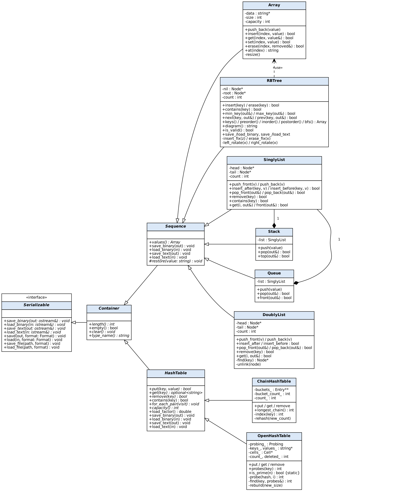
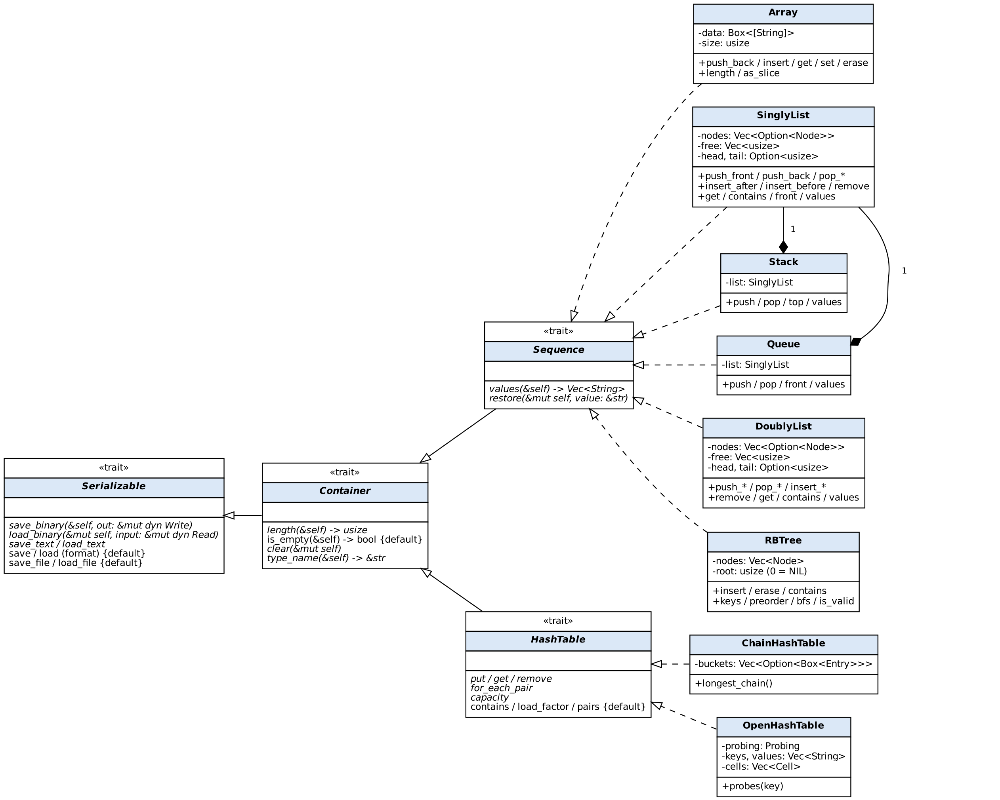
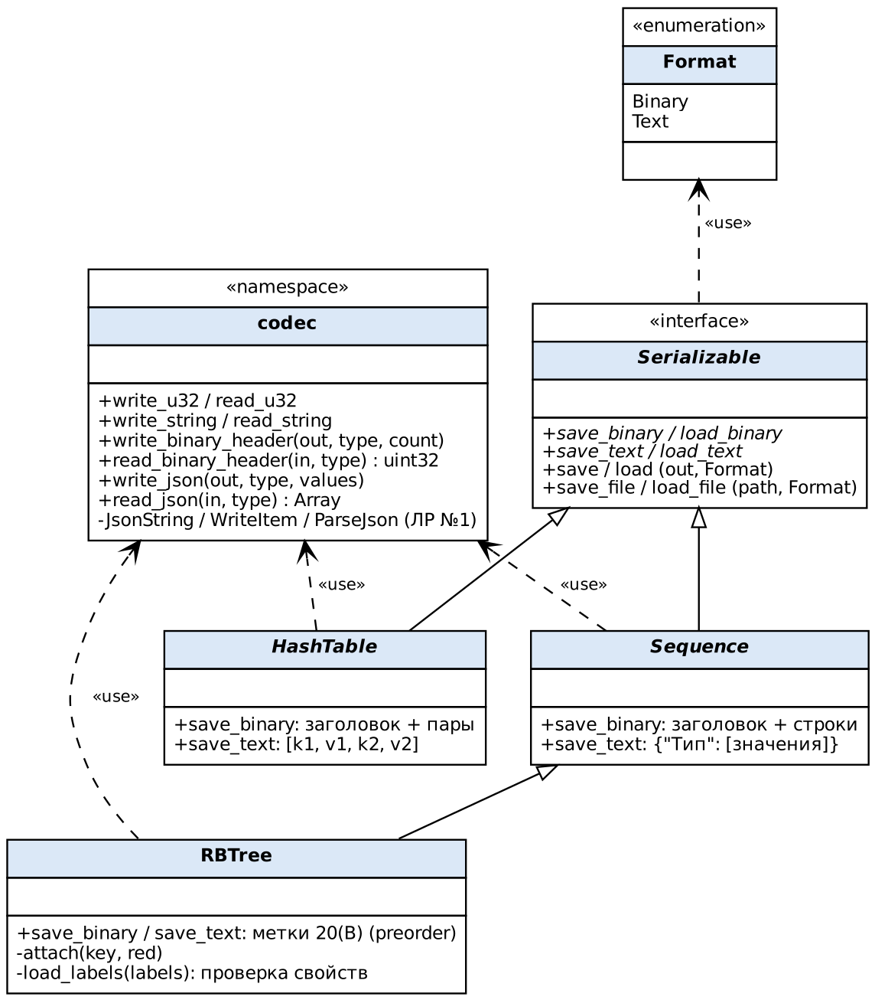

# Лабораторная работа №3: ООП, тестирование и качество кода

## Задание и происхождение алгоритмов

Проект оформляет структуры прежних работ как классы C++ и структуры Rust. В отчёте ЛР1 `D:/лабы код/АБс526_ЩетининИД_ЛР1.docx` указан репозиторий [NothingAboutKiri/lw1](https://github.com/NothingAboutKiri/lw1). Его локальные исходники находятся в `D:/лабы код/cpp/`, в том числе `rb_tree.cpp`; структуры ЛР2 — в `D:/lw2/cpp/structures/`. Алгоритмы поиска, поворотов, вставки и удаления сопоставлены с локальным деревом ЛР1 по шагам; изменены интерфейс, владение памятью и сериализация. Удалённый репозиторий не удалось загрузить из этого окружения из-за недоступности `github.com`, поэтому идентичность локальной копии текущему состоянию репозитория не подтверждена. В ЛР2 находятся массив, односвязный и двусвязный списки, стек, множество с цепочками и открытая хеш-таблица. Их операции перенесены в классы ЛР3; пары «ключ → значение» и сериализация добавлены по заданию ЛР3. Новые предметные алгоритмы из ЛР2 (XML, Хаффман и др.) в задании ЛР3 не требуются.

| Структура ЛР3 | Источник прежней работы | Дополнение ЛР3 |
|---|---|---|
| `Array`, `SinglyList`, `DoublyList`, `Stack` | `lw2/cpp/structures/` | Классы в общей иерархии, копирование, обход, сериализация |
| `Queue` | прежняя C++ работа, `лабы код/cpp/queue.cpp` | Композиция с `SinglyList` |
| `RBTree` | ЛР1: локальный `D:/лабы код/cpp/rb_tree.cpp`, ссылка на репозиторий в отчёте ЛР1 | Копирование, сериализация формы и цветов |
| `ChainHashTable` | `lw2/cpp/structures/hash_set.cpp` | Значения при ключах, базовый интерфейс таблицы |
| `OpenHashTable` | `lw2/cpp/structures/open_hash.cpp` | Значения при ключах, линейный и двойной шаг |

## Объектная модель и UML

`Serializable` задаёт бинарное и текстовое сохранение. `Container` задаёт размер, очистку и имя типа. `Sequence` хранит значения; `HashTable` хранит пары. Общая сериализация размещена в базовых классах, а конкретные контейнеры отвечают за обход и восстановление. Поля структур закрыты; вызовы через `Container` и `Serializable` используют виртуальные методы. Классы с динамической памятью реализуют глубокое копирование и перемещение.

Исходники диаграмм — файлы `.dot` рядом с рисунками. Повторная генерация: `dot -Tpng docs/uml/uml_cpp.dot -o docs/uml/uml_cpp.png` (аналогично для остальных).

## Форматы данных

Структуры (массив, списки, стек, очередь, красно-чёрное дерево) взяты из ЛР №1 без изменения интерфейса: методы возвращают `bool` и результат через параметр-ссылку. Бинарный поток начинается с `L3B1`, имени типа и числа элементов; строки имеют префикс длины. Текстовый формат — JSON из ЛР №1 (`file.cpp` / `file.rs`): `{"Тип": ["v1", "v2"]}`. Для хеш-таблицы ключи и значения идут по очереди, для дерева сохраняются метки прямого обхода вида `20(B)`, по которым восстанавливается точная форма. Загрузка проверяет заголовок, тип и свойства дерева; при ошибке контейнер сохраняет прежнее содержимое. Тесты охватывают оба формата и повреждённый ввод.

## Тесты и покрытие

В C++ есть по 37 тестов для Boost.Test, GoogleTest и Catch2. Это одни и те же сценарии из `tools/gen_tests.py`, выраженные макросами каждого фреймворка; поэтому три файла тестов длинные и во многом повторяют друг друга. Они проверяют операции контейнеров, границы, копирование, свойства дерева, хеширование и сериализацию. Команда `ctest --test-dir cpp/build --output-on-failure` показала прохождение всех трёх наборов. В Rust прошли 29 встроенных модульных и 7 интеграционных тестов. Проверка `cargo clippy --offline --all-targets -- -D warnings` прошла без замечаний.

Покрытие Rust измерено инструментированным `cargo test` и `llvm-cov`: **99,16% строк** (1882 из 1898), **98,41% областей** (3476 из 3532), **99,28% функций** (274 из 276). Учитываются только `rust/src`; тестовые файлы и код стандартной библиотеки исключены. [HTML-отчёт](../rust/coverage/index.html) содержит подсветку каждой строки. Повторить: `cd rust && bash scripts/coverage.sh`.

Суммарное покрытие C++ после запуска Boost.Test, GoogleTest и Catch2 измерено GCC/gcovr по файлам `cpp/src` и `cpp/include`: **98,1% строк** (1263 из 1288), **99,1% функций** (223 из 225), **70,8% ветвей** (855 из 1208). Порог задания 85% выполнен по строкам; по ветвям он не достигнут. Единый [HTML-отчёт](../cpp/coverage/index.html) содержит подсветку исходников и сводку покрытия. Повторить: `cd cpp && bash scripts/coverage.sh`.

## Бенчмарки и линтеры

Google Benchmark в `cpp/benchmarks.cpp` измеряет вставку, поиск и сериализацию при нескольких размерах входа; [результат запуска](bench-cpp.txt) сохранён. Rust-бенчмарк `rust/benches/bench.rs` измеряет медиану повторов и время на элемент для массива, списков, стека, очереди, хеш-таблиц, дерева и обоих форматов. Для корректного сравнения запускать Release-сборку на одной машине без фоновой нагрузки; асимптотика по нескольким точкам показывает тенденцию, но короткий замер не доказывает математическую сложность. Google Benchmark при запуске сообщил о масштабировании частоты процессора и отладочной сборке библиотеки, поэтому его абсолютные времена имеют ограниченную точность.

Фактический запуск `cargo bench --offline --bench bench` сохранён в [bench-rust.txt](bench-rust.txt). Например, при 10 000 элементах вставка в начало массива заняла 170 895 мкс, а добавление в начало односвязного списка — 930 мкс; при 1 000 элементах — соответственно 1 572 и 54 мкс. Это согласуется со сдвигом элементов массива при каждой вставке. Для 100 000 элементов заполнение массива заняло 10 143 мкс, дерева — 58 911 мкс; бинарная сериализация массива с последующей загрузкой — 8 950 мкс, текстовая — 16 511 мкс. Замер поиска отсутствующего элемента списка делает один полный проход; его время на элемент — время прохода, делённое на размер списка.

Для C++ предусмотрен `.clang-tidy` с группами `bugprone`, `clang-analyzer`, `cppcoreguidelines`, `misc`, `modernize`, `performance`, `readability`. Полный запуск нашёл одно замечание о явных скобках в формуле шага хеширования; скобки добавлены, повторная проверка этого файла не показала замечаний по коду проекта. Статический анализатор GCC запущен командой `c++ -std=c++17 -fanalyzer -Wall -Wextra -Wpedantic -Icpp/include -fsyntax-only cpp/src/*.cpp cpp/main.cpp` и завершился без замечаний. Для Rust используется Clippy с `pedantic` и запретом предупреждений. Статические анализаторы ищут подозрительные конструкции без запуска программы и дополняют динамические тесты.

## Теория качества и тестирования

Российские стандарты оценки качества ПО в методических материалах делятся на показатели качества (ГОСТ 28195-89), модели характеристик продукта (ГОСТ Р ИСО/МЭК 25010-2015), процесс оценки (ГОСТ Р ИСО/МЭК 25040-2014), тестирование (серия ГОСТ Р 56920–56922) и статический анализ (ГОСТ Р 71207-2024). Для этой работы критерии превращены в проверяемые действия: многофайловая структура и UML повышают анализируемость; модульные и интеграционные тесты проверяют корректность; покрытие показывает выполненные участки; бенчмарки измеряют производительность; линтеры выполняют статический анализ. Соответствие стандарту целиком эти действия сами по себе не подтверждают.

Модульное тестирование проверяет отдельный класс; интеграционное — взаимодействие, например сериализацию контейнера; системное — программу целиком; приёмочное — выполнение требований заказчика. Тесты «чёрного ящика» строятся по входам и ожидаемым результатам, «белого ящика» — по путям кода; в проекте используются оба подхода. Позитивные случаи проверяют обычные операции, негативные — неверные индексы, пустые структуры и повреждённые данные. Регрессионный запуск повторяет их после изменений. Покрытие строк показывает исполнение кода, но не доказывает отсутствие ошибок; для уверенности нужны проверки результата, границ и инвариантов.

### Российские стандарты и измеримые показатели

| Документ | Предмет | Применение в работе |
|---|---|---|
| [ГОСТ 28195-89](https://protect.gost.ru/gost/details/807dc42e-54b0-4d34-a38d-01fe06aafe5e) | Общие положения и показатели оценки качества программных средств | Выбор проверяемых характеристик |
| [ГОСТ Р ИСО/МЭК 25010-2015](https://protect.gost.ru/gost/details/e5744d86-5a17-4909-96da-b38691326f0c) | Модель качества продукта | Поддерживаемость: модульность, повторное использование, анализируемость, модифицируемость, тестируемость |
| [ГОСТ Р ИСО/МЭК 25040-2014](https://protect.gost.ru/gost/details/8feecd3b-ec9f-4630-8c65-4177976d2c8f) | Процесс оценки качества | Сначала критерий, затем измерение и вывод |
| [ГОСТ Р 56920-2024](https://protect.gost.ru/gost/details/add71c89-4533-46c0-956a-887531f967dc) | Общие положения тестирования ПО | План тестов и воспроизводимый запуск |
| [ГОСТ Р 71207-2024](https://protect.gost.ru/gost/details/9dd6f064-6014-4416-a3ca-ef72ce0a6c3a) | Требования к статическому анализу | Clippy, clang-tidy и анализатор GCC |

Наблюдаемые показатели проекта: доля выполненных строк, функций и ветвей; число пройденных тестов; отсутствие ошибок линтера; медианное время операций. Покрытие 98,1% относится к строкам C++; покрытие ветвей 70,8% показывает, что отдельные альтернативы условий ещё не исполнены. Нельзя подменять один показатель другим или считать процент покрытия оценкой качества всей программы.

### Виды и принципы тестирования

| Классификация | Виды | Пример проекта |
|---|---|---|
| Уровень | модульное, интеграционное, системное, приёмочное | методы списка; сохранение и загрузка; `lab3_demo`; проверка задания |
| Доступ к устройству | чёрный, белый и серый ящик | ожидаемый порядок значений; инварианты дерева и покрытие ветвей |
| Цель | функциональное, производительности, нагрузочное, регрессионное | сравнение результатов; Google Benchmark; повторный запуск тестов |
| Метод | статическое и динамическое | Clippy и clang-tidy; исполнение тестов |
| Входные данные | позитивное, негативное, граничное | вставка; неверный индекс; пустой контейнер |

Семь принципов ISTQB: тестирование обнаруживает наличие дефектов, но не доказывает их отсутствие; исчерпывающее тестирование невозможно; раннее тестирование экономит исправления; дефекты часто сосредоточены в отдельных модулях; неизменные тесты со временем теряют эффективность; стратегия зависит от контекста; даже программа без найденных ошибок может не соответствовать потребностям. Разработчик обязан тестировать собственный код, а независимая проверка помогает увидеть пропущенные предположения. [Программа ISTQB CTFL](https://istqb.org/wp-content/uploads/2024/11/ISTQB_CTFL_Syllabus_v4.0.1.pdf) описывает принципы, уровни, техники и независимость тестирования.

Краткие ответы на все вопросы к защите, включая устройство классов, хеширование, виртуальные функции и команды создания HTML, приведены в отдельном текстовом файле [DEFENSE.txt](DEFENSE.txt). Теоретическая часть вместе с этими ответами короче ограничения в 15 страниц при обычном оформлении отчёта.

### Список использованных источников

1. [ГОСТ 28195-89. Оценка качества программных средств. Общие положения](https://protect.gost.ru/gost/details/807dc42e-54b0-4d34-a38d-01fe06aafe5e).
2. [ГОСТ Р ИСО/МЭК 25010-2015. Модели качества систем и программных продуктов](https://protect.gost.ru/gost/details/e5744d86-5a17-4909-96da-b38691326f0c).
3. [ГОСТ Р ИСО/МЭК 25040-2014. Процесс оценки](https://protect.gost.ru/gost/details/8feecd3b-ec9f-4630-8c65-4177976d2c8f).
4. [ГОСТ Р 56920-2024. Тестирование программного обеспечения. Общие положения](https://protect.gost.ru/gost/details/add71c89-4533-46c0-956a-887531f967dc).
5. [ГОСТ Р 71207-2024. Статический анализ программного обеспечения](https://protect.gost.ru/gost/details/9dd6f064-6014-4416-a3ca-ef72ce0a6c3a).
6. [ISTQB. Certified Tester Foundation Level Syllabus, v4.0.1](https://istqb.org/wp-content/uploads/2024/11/ISTQB_CTFL_Syllabus_v4.0.1.pdf).
7. Майерс Г. и др. *Искусство тестирования программ*. М.: Диалектика, 2020.
8. Бек К. *Экстремальное программирование: разработка через тестирование*. СПб.: Питер, 2023.
9. Назина О. *Что такое тестирование. Курс молодого бойца*. БХВ, 2022.
